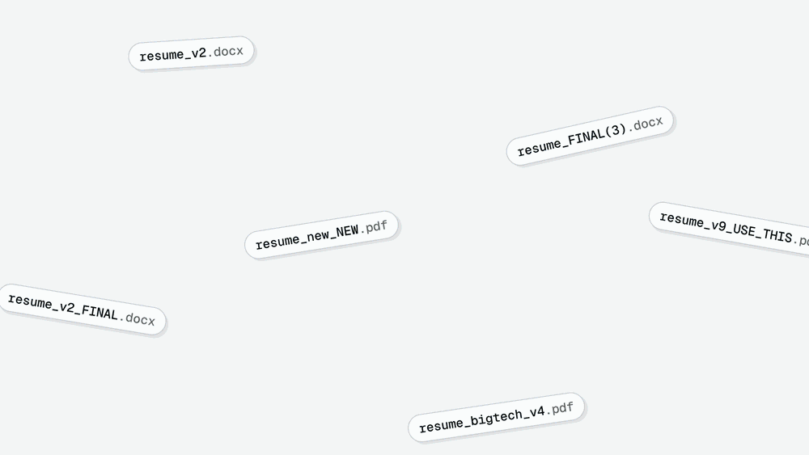

<p align="center">
  <picture>
    <source media="(prefers-color-scheme: dark)" srcset="docs/assets/brand/maestro_lockup_dark.svg">
    
  </picture>
</p>

<p align="center">
  <a href="https://github.com/seinun-ai/maestro-career-studio/actions/workflows/ci.yml"></a>
  <a href="https://github.com/seinun-ai/maestro-career-studio/actions/workflows/codeql.yml"></a>
  <a href="https://github.com/seinun-ai/maestro-career-studio/actions/workflows/ci.yml"></a>
  <a href="LICENSE"></a>
  <a href="https://maestrocareerstudio.com"></a>
  <a href="https://github.com/seinun-ai/maestro-career-studio/pkgs/container/maestro-career-studio-backend"></a>
</p>
<!-- The ghcr badge went up with v0.1.1, once both packages were public — a
     badge for a private package renders as a broken promise. It and the static
     test-count badge are refreshed from the release checklist in
     docs/RELEASING.md; edit them there, not here. -->

# Stop rewriting your resume for every job.

Maestro tailors it from your whole career history in under a minute, and every bullet is something you actually did, so you can defend it in an interview.

- **Same score, every time.** The match score runs on fixed rules and a small model on your own computer, with no AI service involved. Same resume, same job, same number.
- **Every AI edit is a diff.** Suggested changes arrive as a before and after. You accept or undo them one by one.
- **It fills the form and stops there.** The Companion fills job applications from your saved answers and attaches your resume. It never submits. That click is yours. With full automation on, **Apply** can also click Next through the pages for you and stops on the review page. On known application sites it signs in, or makes the account, with the job-site login you saved.

**[Install in two commands](#quickstart)**, or follow the [Getting Started guide](docs/GETTING_STARTED.md) if this is all new to you.

<!-- hero.gif: career-history animation, approved by the owner 2026-10-12 for the
     launch. All data is the fictional Jordan Ellis persona (example.com email,
     555 phone, sample-company employers, target "Woodgrove Bank"). The resume
     pages, the 82.4 -> 87.3 Match score and the Apache Spark gap card are real
     captures from the app (v0.10.1) on a throwaway stack; tailoring took 4.6 s.
     Source, captures and the encode script live in the private marketing repo
     (hero-gif/; the Figtree captions are hero-site-figtree/, re-rendered 2026-10-16
     to match the site). 1000px / 12fps / 32 colors, no dither, 1.86 MB; keep any
     replacement under 2 MB. -->



## Give your AI your career

Connect Claude, Codex or the ChatGPT desktop app and your assistant gets your career history, your resumes and your jobs. Then just ask.

| | You ask | What happens |
|---|---|---|
| **Extract** | "Here's a posting. Should I even apply?" | It saves the job, scores your resumes against it and flags knock-outs like visa or years of experience. |
| **Maintain** | "I shipped the fraud model this quarter. Add it." | A new bullet, as a draft you approve, that every resume can use. |
| **Maintain** | "Make me a resume for fintech ML roles in the UK." | A specialist resume built from your history, targeted to that role and country. |
| **Hunt** | "Every morning, find new ML roles that fit and file the good ones." | The job-hunt skill files them to your Agent inbox. You queue or skip each one. |
| **Hunt** | "Which skills keep showing up that I don't have?" | The gaps across every job you saved, most frequent first. |
| **Apply** | "Tailor this one, walk me through the gaps, then make the PDF." | It asks about each gap instead of inventing, keeps every change as a diff you can undo and renders the PDF. |
| **Apply** | "Fill the applications I queued. Show me each one before it goes." | Nothing is submitted without your yes, unless you turn on full automation. |

That is 91 tools and ready-made skills for a daily hunt, an apply run and email status: see the [MCP guide](backend/mcp_server/README.md).

**Free and open source.** Your career history lives on your laptop, not in someone else's cloud, and there is no account. Bring an OpenAI, Gemini or Claude key (scoring, PDFs and tracking work without one), get real LaTeX and Typst PDFs, and take everything with you in one `career.md` file.

> **Made for one person on one computer.** There is no login, so anything that
> can reach the app can read and change your whole career record and your saved
> API keys. Out of the box it only listens on your own machine (`127.0.0.1`).
> **Never expose the app to a network.** The one published path is `/api/sync`,
> sealed, and only as [sync setup](docs/sync-setup.md) describes.
> [`SECURITY.md`](SECURITY.md) has the details. Your career record stays on
> your computer. When you use AI features, resume and job information goes to
> the AI service you choose.

---

## Why it works this way

If your resume folder has a `v2finalcopy(3)` in it, this is for you. Maestro keeps one record of what you have actually done, and every resume is a view of that record. Approved bullets go into a resume word for word, and rewording one is a separate step that asks you first. When a job asks for something your resume does not show, Maestro asks you about it. If it is true, it is saved for every future application. If it is not, it stays a gap.

The score is fixed rules, so the same resume and job always get the same number. It is not an employer's score or a prediction of an interview, so use it to compare your own drafts. Saving a job and tailoring for it took about 10 seconds on Gemini and about 40 on the OpenAI default in our tests, at about $0.01 (OpenAI) or under $0.03 (Gemini) per application ([the numbers](docs/USING_MAESTRO.md#5-choose-your-models-deliberately)).

Nothing here is rented. It is free and open source (Apache 2.0), with no account, and you pay only for the AI you use. Your career has one history. Your resume should too.

The long version, with the score, tailoring, templates and the rest of the toolkit, is in [Using Maestro CS](docs/USING_MAESTRO.md).

---

## Quickstart

Install [uv](https://docs.astral.sh/uv/) once. After that, Maestro is two commands: no Docker, no Git, no clone. uv installs Maestro as a single `maestro` command and fetches the Python it needs, and the package brings its own web app and its own Node. It runs on macOS, Linux and Windows (x64).

```bash
# 1. Install uv once, then open a new terminal.
curl -LsSf https://astral.sh/uv/install.sh | sh     # macOS and Linux
```

```powershell
# On Windows, in PowerShell instead of the line above:
powershell -ExecutionPolicy ByPass -c "irm https://astral.sh/uv/install.ps1 | iex"
```

```bash
# 2. Install Maestro, then start it.
uv tool install --python 3.12 maestro-career-studio
maestro start
```

`maestro start` runs Maestro in the background and opens **http://localhost:3000**.
Closing the terminal does not stop it. The first start downloads the small
scoring model (about 100 MB, once) from Hugging Face, so allow a minute or two.
If the terminal says `maestro` is not found, run `uv tool update-shell` and open a
new terminal.

Best effort, not tested: **Windows on ARM** has no PDF-engine (typst) wheel, so install an x64
Python under emulation: `uv tool install --python cpython-3.12-windows-x86_64-none maestro-career-studio`.
**Alpine and other musl Linux** are not supported by the PDF engine's wheels; use a glibc distro or Docker.

Then:

1. Add your AI key in **Settings › Basics**. One key from OpenAI, Gemini or Claude is enough. Without a key, scoring, PDFs and tracking still work ([what a key costs and does](docs/SETUP_REFERENCE.md#do-you-need-an-api-key)).
2. Import your resumes, save a job, and tailor ([step by step](docs/GETTING_STARTED.md#3-your-first-tailored-resume)).
3. Optional: `maestro connect` adds Maestro to Claude Desktop, Claude Code, Codex, Cursor or VS Code, and the [Companion](docs/GETTING_STARTED.md#4-the-companion-browser-extension-optional) is a Chrome side panel for saving and filling job pages.

| Command | What it does |
|---|---|
| `maestro start` | Start Maestro and open the app (`--no-browser`, `--skip-model`) |
| `maestro stop` | Stop it |
| `maestro status` | Whether it is running, its version and whether a newer one exists (`--offline` skips that check, `--json` for scripts; exit code 3 means stopped) |
| `maestro update` | Save a snapshot of your data, update, restart (`-y` skips the question) |
| `maestro connect [app]` | Add Maestro to Claude Desktop, Claude Code, Codex, Cursor or VS Code |
| `maestro import-docker CHECKOUT` | Move your data from a Docker install into this one, once (`--dry-run` shows the plan; [steps](docs/UPDATING.md#move-from-docker-to-the-uv-install)) |

[The full command table](docs/SETUP_REFERENCE.md#the-maestro-command-and-the-uv-install) also covers `logs`, `open`, `restart`, `autostart`, `backup`, uninstalling and TeX for LaTeX templates. What the command contacts, and when: [PRIVACY.md](PRIVACY.md#what-the-maestro-command-and-first-start-download).

> **Young, but rehearsed.** The app runs daily on my machine. A fresh Docker
> install (clone, start, first tailored resume) has been checked end to end on a
> second machine, and CI installs and starts the uv package on macOS, Linux and
> Windows for every change. It has had little testing on machines that
> aren't mine. If it fails on yours, please
> [open an issue](https://github.com/seinun-ai/maestro-career-studio/issues)
> with the log. That report is one of the most valuable contributions there is.

## Alternative: run with Docker (self-hosters)

Docker stays the route for contributors and for servers. It needs Docker, Git and about a 1 GB download (roughly 3–4 GB unpacked); the [prerequisites](docs/SETUP_REFERENCE.md#prerequisites) have the detail, and on Windows you run it under WSL ([steps](docs/GETTING_STARTED.md#on-windows-use-wsl)).

```bash
# 1. Download the project and create your settings file
git clone https://github.com/seinun-ai/maestro-career-studio.git
cd maestro-career-studio
cp .env.example .env

# 2. Start the app (downloads about 1 GB the first time)
docker compose up -d
```

Then open **http://localhost:3000** and add your AI key in **Settings › Basics**. The first start sets up your database and adds a demo resume so you have something to look at. The rest of the Docker route is in the [setup reference](docs/SETUP_REFERENCE.md#the-docker-route-in-full).

**Docker and uv are separate copies.** They keep separate data, and both want ports 8001 and 3000, so run one at a time. **Moving from Docker to uv?** Stop Docker, install Maestro as above, then run `maestro import-docker CHECKOUT` once ([steps](docs/UPDATING.md#move-from-docker-to-the-uv-install)). It reads your Docker folder and changes nothing in it.

## Working with AI assistants

### Driving it from Claude, Codex, or ChatGPT (MCP)

**MCP** is the connector that lets an AI assistant use the app for you: read a posting, score it, work the gaps, make the PDF, all in conversation, on your computer against your data. All 91 tools are on by default, and smaller tool sets (`hunt`, `apply`, `explore`, `templates`, `career`) keep a chat focused. On a uv install, run `maestro connect`; otherwise open Settings › Agent apps › **Connect an agent app**. Setup, example prompts, tool sets and the ready-made skills are in [Using Maestro CS](docs/USING_MAESTRO.md#driving-it-from-claude-codex-or-chatgpt-mcp) and the [MCP guide](backend/mcp_server/README.md). An [always-on bot](docs/always-on-bot.md) can work your search while your laptop is off.

### Going all the way: agent applications

Maestro CS can take an application right up to the submit button. A job your agent finds becomes a **proposal**. You review proposals in the **Agent inbox** and queue or skip them, and an apply run works only the ones you queued. By default it **waits for your yes before each submit**. **Full automation** (off by default, in Settings › Agent apps) lets your agent submit a queued job without asking when its final review shows nothing to check, within your daily limit. Nothing is ever submitted from the web app itself, and the Companion never presses Submit. That yes is recorded by the agent, so it is an audit trail and a volume limit, not a lock that a manipulated agent can't pick: run it while you're watching. The risks, plainly: a job posting is untrusted text that can try to instruct the agent reading it, a posting the agent found is not a vetted employer, and we won't help you hide automation from bot detection. Read the [full section](docs/USING_MAESTRO.md#going-all-the-way-agent-applications) before you turn it on.

---

## Updating

**Installed with uv?** Run `maestro update`. It checks PyPI for a newer release, prints any breaking changes from the changelog, saves a verified snapshot of your data, stops Maestro, updates it and starts it again.

**On Docker?** From the folder you cloned, run `./scripts/update.sh` (`--check` only tells you whether you're up to date). It needs bash, so on Windows run it under WSL.

Your data is not touched by an update, and **deleting the project folder does delete it** on the Docker route. After updating, reload the browser extension and restart your AI assistant so it sees new tools. [`docs/UPDATING.md`](docs/UPDATING.md) has the rest: updating by hand, pinning a version, what the backup covers, rolling back, and coming from v0.3.0 or older.

## Where your files live

A uv install keeps everything in one folder per user: the database, resumes, settings, backups, logs and `maestro.env` (your API keys and, if you need them, port overrides). Deleting the folder deletes your data.

| System | Folder |
|---|---|
| macOS | `~/Library/Application Support/Maestro Career Studio` |
| Windows | `%APPDATA%\Maestro Career Studio` |
| Linux | `$XDG_DATA_HOME/maestro-career-studio` (default `~/.local/share/maestro-career-studio`) |

Finished resume PDFs are also copied to `Documents/Maestro Career Studio/Applications`, one folder per job (Settings › Basics › Resume PDFs).

On the Docker route everything stays inside the folder you cloned (`data/`, `base_resumes/`, `applications/`, `settings/` and more; the [full list](docs/SETUP_REFERENCE.md#where-your-files-live-docker)). Your files are yours, never uploaded. Every application's PDF is saved in `applications/`, and `career.md` exports your whole career history as one Markdown file.

## Troubleshooting

`maestro status` and `maestro logs` come first, and a port already in use is named in the message. `maestro check` prints the install's facts as JSON to paste into an issue. Ports, API keys and quota errors, "database is locked", PDFs that fail to build and an empty app after updating are covered in [Troubleshooting & Common Questions](docs/SETUP_REFERENCE.md#troubleshooting--common-questions).

## Community, Documentation & Contributing

**Contribution fast-path:** docs fixes, resume/cover-letter templates and
extension job-board adapters go straight to a pull request — no issue needed.
Features and bigger changes: open an issue first. Every pull request gets a
human reply within 48 hours and is read by a human — we don't merge AI slop.

This is an early release. If something doesn't work, please say so — a clear bug
report is one of the most valuable contributions right now.

- **Project site:** [maestrocareerstudio.com](https://maestrocareerstudio.com) — a five-minute tour before you install anything.
- **Getting Started:** [`docs/GETTING_STARTED.md`](docs/GETTING_STARTED.md) — install to first tailored PDF, step by step.
- **Using Maestro CS:** [`docs/USING_MAESTRO.md`](docs/USING_MAESTRO.md) — how it works, how to use it well, and the rest of the toolkit.
- **Setup reference:** [`docs/SETUP_REFERENCE.md`](docs/SETUP_REFERENCE.md) — the `maestro` command, prerequisites, API keys, local models and troubleshooting.
- **Updating:** [`docs/UPDATING.md`](docs/UPDATING.md) — updating by hand, backups, rolling back.
- **Known issues:** [`KNOWN_ISSUES.md`](KNOWN_ISSUES.md) — what works well, what's rough, and what's a deliberate limitation.
- **Skills for your AI assistant:** [`docs/skills/`](docs/skills/) — job hunt, apply run, mail status, referral pages, tailor run, and a skill that builds your own; the app's **Automations** page copies each as a prompt.
- **Contributing:** [`CONTRIBUTING.md`](CONTRIBUTING.md) — development setup, tests, development mode and LLM tracing, and where help is wanted. [`SYSTEM.md`](SYSTEM.md) is the architecture reference for contributors and coding agents; read the relevant part before changing behaviour. [`UBIQUITOUS_LANGUAGE.md`](UBIQUITOUS_LANGUAGE.md) is the project's vocabulary, worth ten minutes before your first contribution.
- **Changelog:** [`CHANGELOG.md`](CHANGELOG.md) — what changed in each release; read any **Breaking changes** heading before [updating](#updating). Maintainers: [`docs/RELEASING.md`](docs/RELEASING.md).
- **Security & privacy:** [`SECURITY.md`](SECURITY.md) — the local-only rule and how to report a vulnerability. [`PRIVACY.md`](PRIVACY.md) — what is stored, and what leaves your computer.
- **License:** [`LICENSE`](LICENSE) — Apache License 2.0, plus [`NOTICE`](NOTICE).

## Privacy Policy

There is no Maestro CS server or account, and the author never receives your
data. Your career record stays in files on your computer; it goes to an AI
service only when you add a key and use an AI feature, and to the assistant you
connect over MCP when it calls a tool. With a model on your own computer, the
app sends nothing out. [`PRIVACY.md`](PRIVACY.md) has the full policy: what is stored, every
place data can go, retention, and how to ask a question.

## Licensing

Maestro CS is free software under the **[Apache License 2.0](LICENSE)**.

**You may use it commercially, and you don't have to publish your changes.**
Fork it, build it into a product, run a modified copy as a hosted service — all
permitted. Apache 2.0 asks three things in return: keep the license and
copyright notices, say what you changed in the files you changed, and pass along
the [`NOTICE`](NOTICE) file with any redistribution. It also includes an
**explicit patent grant** from every contributor, the main practical reason to
prefer it over MIT or BSD.

Credits for the third-party pieces we redistribute — the LaTeX resume template,
the XCharter font, the scoring model — are in
[`THIRD_PARTY_NOTICES.md`](THIRD_PARTY_NOTICES.md), which the license also asks
you to carry forward.

**No CLA.** Contributions are licensed under Apache 2.0 by
[section 5](LICENSE) of the license itself; there's nothing to sign. Commercial
questions: **ajey@seinun.com**.

## Credits & Citation

Maestro Career Studio is a free, open-source project from
[Seinun LLC](https://seinun.com). It stands on other people's work. The full
list — bundled sources, the scoring model, the PDF tools, and every dependency with its license — is in
[`THIRD_PARTY_NOTICES.md`](THIRD_PARTY_NOTICES.md). The ones that shape the
product most:

- **[Jake's Resume](https://github.com/jakegut/resume)** by Jake Gutierrez (MIT)
  — the LaTeX resume and cover-letter templates are adapted from it.
- **[BAAI/bge-small-en-v1.5](https://huggingface.co/BAAI/bge-small-en-v1.5)**
  (MIT) — the small model behind the match score, running on your computer.
  Please cite [C-Pack (arXiv:2309.07597)](https://arxiv.org/abs/2309.07597) if
  you build on the scoring engine.
- **[TeX Live](https://tug.org/texlive/)** and
  **[Typst](https://github.com/typst/typst)** — the two PDF engines, with
  XCharter and FontAwesome 5 for type and icons.
- **[Next.js](https://nextjs.org)**, **[React](https://react.dev)**,
  **[Tailwind CSS](https://tailwindcss.com)**, **[Base UI](https://base-ui.com)**,
  **[shadcn/ui](https://ui.shadcn.com)**, **[Monaco Editor](https://github.com/microsoft/monaco-editor)**,
  **[FastAPI](https://fastapi.tiangolo.com)**, **[SQLAlchemy](https://www.sqlalchemy.org)**,
  and **[fastembed](https://github.com/qdrant/fastembed)** carry the rest.

Using Maestro CS in published work? Cite it with GitHub's **"Cite this
repository"** button, which reads [`CITATION.cff`](CITATION.cff).
