# Using Maestro CS

This is the part of the README that explains what Maestro does and how to use it well: why it works the way it does, how the score and tailoring work, the five steps of a job search in the app, how to drive it from Claude, Codex or ChatGPT, and the rest of the toolkit. The install steps are in the [README Quickstart](../README.md#quickstart) and, step by step, in [Getting started](GETTING_STARTED.md). Keys, prerequisites and troubleshooting are in the [setup reference](SETUP_REFERENCE.md).

**Contents:**
[Why Maestro CS?](#why-maestro-cs) ·
[Using it well](#using-it-well) ·
[Driving it from Claude, Codex, or ChatGPT (MCP)](#driving-it-from-claude-codex-or-chatgpt-mcp) ·
[Always-on bot (optional)](#always-on-bot-optional) ·
[The rest of the toolkit](#the-rest-of-the-toolkit)

---

## Why Maestro CS?

**Your time belongs in your career, not in the paperwork around it.** Most of a
job search goes into documents thrown away a week later: a resume rebuilt for
each role, a cover letter written again from memory, the same "tell us about a
time you…" answered for the fourth time. Here you record what you actually did
once, and every document after that is assembled from that record.

**It never writes things you didn't do.** Your work goes into one **career
history**. Resumes are built from the bullets you approved, word
for word; rewording a bullet is a separate step that asks you first. When a job
asks for something your resume doesn't show, Maestro asks you about it — if it's
true, it's saved for every future application; if not, it stays a gap. Every
change is saved as a **resume version**, so you can always compare or go back.

**Real, professional PDFs without the formatting headache.** You edit content in
a simple editor — a bullet is a bullet — and a template handles the layout, so
changing a word can never break the formatting. Switch templates any time
without touching your content, or bring your own design.

**Nothing here is rented.** Free and open source (Apache 2.0), no account, no
subscription. Use the AI service you choose and pay only for what you use —
about $0.01 per application.

### How it works

- **Your career record.** Upload every resume version you have. Maestro merges
  them into one record of your jobs, projects and skills, removing duplicates.
  Bullets taken unchanged from your files are approved automatically; anything
  merged or written by AI waits for your review.
- **The match score.** Maestro compares your resume with a saved job using
  fixed scoring rules plus a small model that runs on your computer — no AI
  service is involved, so the same resume and job always get the same 0–100
  score. It is **not** an employer's score or a prediction of an interview; use
  it to compare your own drafts and catch gaps. One thing moves over time:
  recent experience counts more, so a score can shift slightly as months pass
  ([`KNOWN_ISSUES.md`](../KNOWN_ISSUES.md)).
- **Tailoring.** Suggested changes arrive as a before/after view you accept or
  undo, one by one. Tailored lines are written as you would say them ("Built X",
  never "He built X"). **Use resume as is** keeps your base text unchanged, so fix
  a line written about you in the third person in the base resume itself.
- **PDFs.** Built on your computer with LaTeX or Typst, two professional
  typesetting systems.

### How it compares

Only claims you can check yourself (as of August 2026 — tell us if a row has
gone stale):

| | Typical AI resume builders | CLI skill frameworks | **Maestro CS** |
|---|---|---|---|
| Match scoring | An AI guesses — same input, different score each run | AI judgment | **Fixed rules — same input, same score, every time** |
| Shows whether tailoring helped | Static score only | Not measured | **Score before and after, per application** |
| See what the AI changed | No history | No | **Every change shown, undoable** |
| PDF output | House web templates | HTML → PDF | **LaTeX and Typst, bring your own template** |
| Career record | None (per document) | Plain markdown/YAML files | **Organized, versioned — exports to one `career.md`** |
| Works with AI assistants | No | Command-line skill files | **95 tools for Claude, Codex, ChatGPT desktop — on your own computer** |
| Submits applications for you | N/A | Never (stated) | **Only with your yes per application, or with Full automation you turn on** |
| Cost | $15–75/month | Free + AI usage | **Free (Apache 2.0) + your own AI usage — [about $0.01 per application](SETUP_REFERENCE.md#do-you-need-an-api-key)** |

---

## Using it well

Maestro CS is built for **fewer, stronger applications**, not volume. Most
openings now draw hundreds of applicants, and many employers filter out resumes
that read as machine-written — so the leverage is in depth per application.

**Words you'll see:**

- **Career history** — one organized record of your work, built from your
  resumes. Each job, project or school in it is an **item**; each line is a
  **bullet**.
- **Base resume** — your main resume for one kind of role, such as Data Scientist.
- **Tailoring** — adjusting a base resume to one job, using only things you
  actually did.
- **Match score** — Maestro's comparison of your resume with a saved job
  description. It is not an employer's score or a prediction of an interview.
- **AI service** — OpenAI, Gemini or Claude, whichever you choose.

### 1. Build your career history first (once)

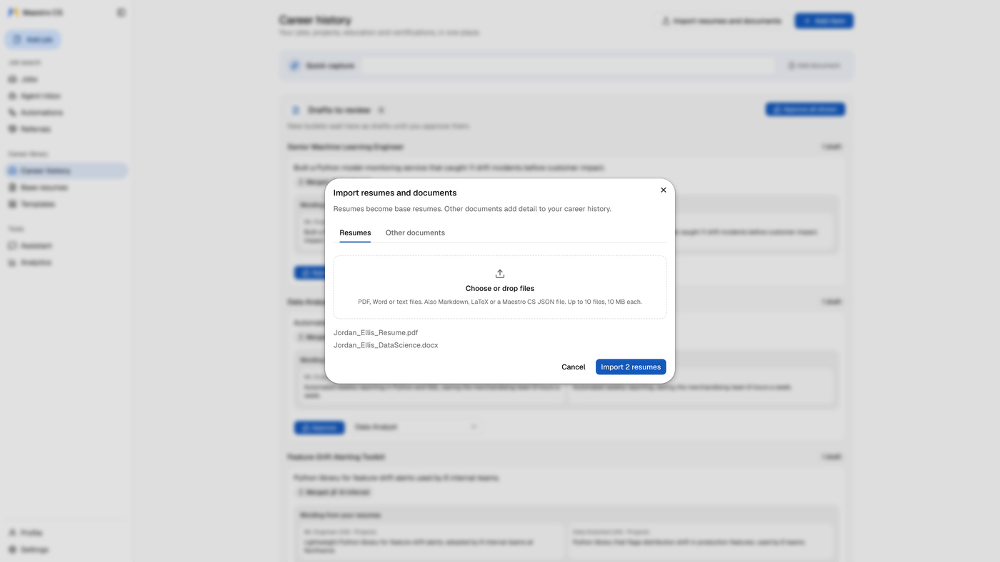

Upload **every** resume version you have — old ones, role-specific ones, the
too-long one. Maestro merges duplicates across them and builds one **career
history**: your verified record in one place.

This step pays off every time. Everything later is built from approved bullets,
so its quality is the ceiling on everything else. Add certifications,
project write-ups and performance-review notes too — anything true about your
work can become evidence later. Import PDF, DOCX, PowerPoint (.pptx, including
speaker notes), Markdown or text files.

> **Review your drafts before tailoring.** Bullets taken unchanged from your files
> are approved on import; anything merged across resumes, or written by AI,
> waits in **Drafts to review**. Only approved bullets go into a resume, and fixing a
> duplicate once fixes every future application.

### 2. Build a base resume per career track

<!-- base-resume.png refreshed 2026-08-23 (post UI-clarity round). Contact
     header is the approved public set (sanitized +1-999-999-9999,
     ajey@seinun.com); "Liberty Hill, TX" experience location previously
     reviewed and accepted. 1400px wide to match the asset set. -->

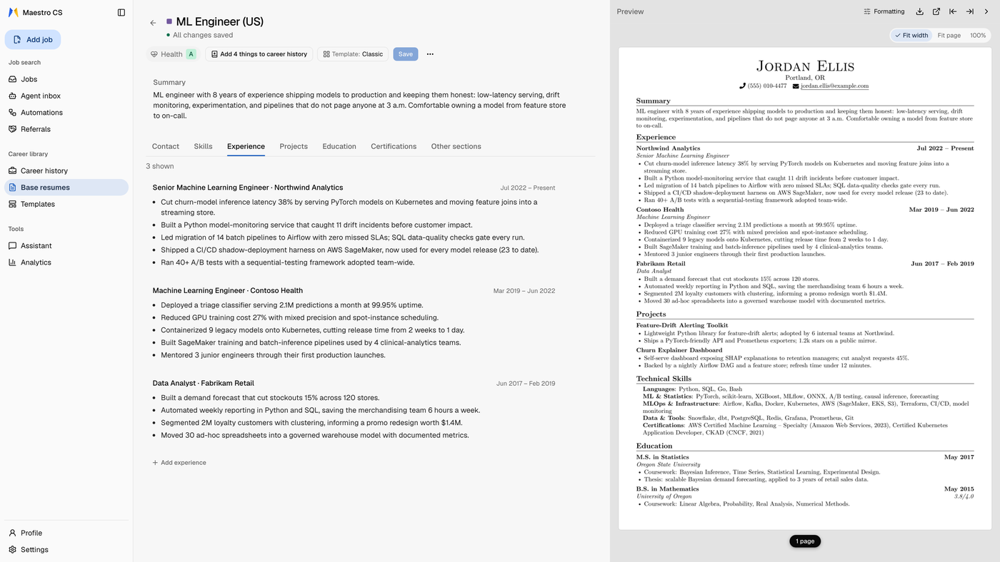

One base per kind of role you actually target (such as *Data Scientist* or *ML
Engineer*) — not one per job. **New base resume › From career history** suggests
which entries belong, with a reason for each one it leaves out, plus a drafted
summary.

<!-- kb-import.png captured 2026-08-23: the editor's Add from career history
     drawer; background contact panel deliberately blurred at capture time. -->

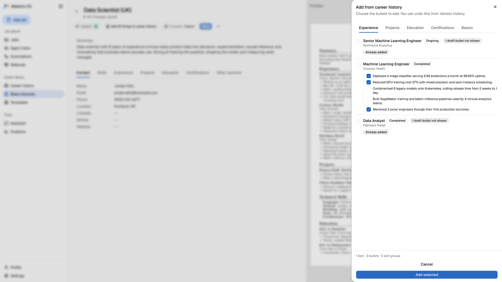

The optional instruction box steers the *shape*, not the facts: "lead with
pipeline and cloud work, keep it mid-level, leave off teaching." **Bullets are
never rewritten at this step** — approved bullets go in word for word, which is
what keeps a generated resume defensible.

### 3. Save the job, then close the gaps

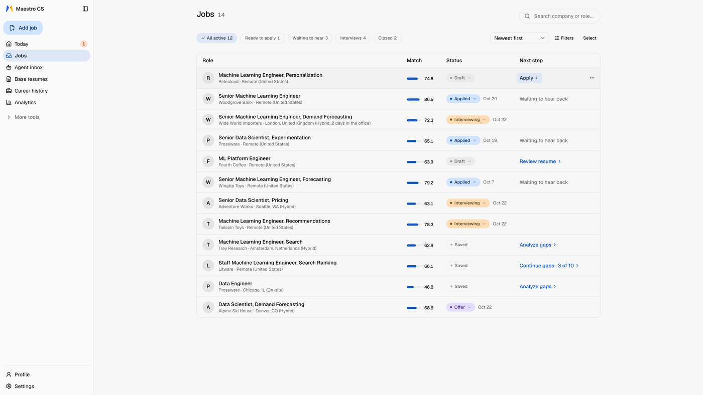

Paste the job description (**Add job**) or save it with the Companion. Saving
scores it against your base resumes, and **Save job** opens the job on its
**Resume and gaps** step. Scoring uses no AI service, so the same
resume and job always get the same number. On **Jobs**, each row's **Next step**
says what the job is waiting for.

<!-- Screenshots in this guide were retaken 2026-10-12 on v0.10.1 with the
     fictional demo persona (Jordan Ellis, example.com, sample-company names);
     sources live in the private marketing repo (site-media/). -->

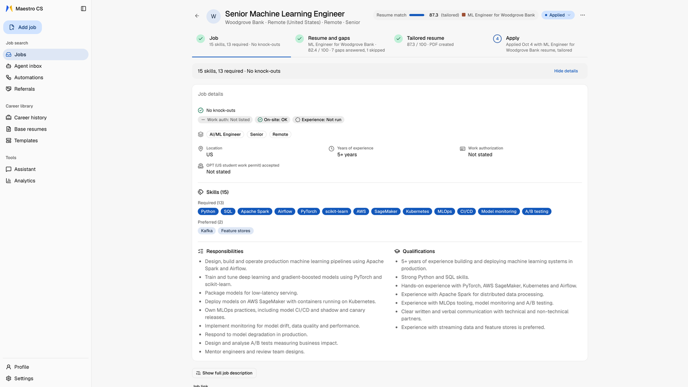

Every saved job also gets a **requirements check**: what the posting *states*
about work authorization, visa (OPT) policy, salary and years of experience,
compared with your profile — so a mismatch shows up now, not at the screening
call. It is a banner only when something blocks you (a conflict, or an answer
your profile is missing); otherwise it is one small line in the job's details.

The top of a job's page answers two things: what you do next, and where the job
stands. The header carries one status and one score (**Resume match** once the
job has its own tailored resume, **Best base resume** before). Under it are four
numbered steps, **Job**, **Resume and gaps**, **Tailored resume** and **Apply**,
each with one line saying what is done or what comes next. A job has one
application: tailoring it with another resume replaces the draft after asking,
and version history keeps the old one.

Then work through the **gaps** rather than accepting a rewrite. Maestro asks
targeted questions to find things that are true but not yet written down. Your
answers are saved to your career history, so closing a gap once helps every
future application.

> **About the score.** It's *our* score: fixed and repeatable, but **not** a
> prediction of what an employer's system shows — no consumer tool can offer
> that. Independent tests make the point: the same resume scored
> [66–99 across 100 runs](https://danunparsed.com/p/hackerrank-open-source-ats)
> on a popular AI-judged checker, with an
> [18-point spread](https://resumeoptimizerpro.com/blog/ats-resume-checker-tools-compared)
> across five commercial ones. Use ours to compare your own drafts and catch
> gaps. Chasing 100 produces keyword-stuffed resumes that modern screens flag.
>
> **Languages.** English resumes and job postings, including accented letters
> (*Zürich*, *José*, *São Paulo*). Non-Latin scripts (Chinese, Japanese, Korean,
> Cyrillic, Arabic, Hebrew, Devanagari, Thai) aren't supported yet and are
> refused on import rather than given a misleading score.

### 4. Generate the package, then read it

Cover letter, screening answers, and the PDF. Read everything before it goes
anywhere — it's your name on it.

### 5. Choose your models deliberately

**Settings › Advanced › Model per job** has four model roles: **Fast** (reading postings, bulk work),
**Smart** (tailoring, finding gaps), **Assistant** (the in-app Assistant) and
**Reasoning** (used only when the Companion's Apply is stuck on a page). Left
unset, the Reasoning model is your provider's strong model (Claude Sonnet 5.5 or
GPT-6.1 Sol), or your Smart model for other providers. We
tested the combinations of the first three on real job postings, and the **Fast** model turned out
to decide almost everything — how completely a posting's requirements are read,
how honest your score is, and most of the waiting time. So it comes down to two
tested setups, one per AI service:

| | **OpenAI** · most thorough | **Gemini** · fastest |
|---|---|---|
| Fast, Smart and Assistant set to | `gpt-5.6-luna` | `gemini-3.7-flash` |
| The one key you need | OpenAI | Gemini |
| Job requirements captured | the most complete we measured | about ¾ of that, strongest on named tools |
| Save + tailor takes | ~40 seconds | ~10 seconds |
| Cost per application | **about $0.01** | **under $0.03** *(Gemini promo pricing doubles Jan 2027)* |
| Made-up skills | none measured | none measured |

| | **Claude** · your key, your roles |
|---|---|
| The one key you need | Claude (Anthropic) |
| Models you can pick | `claude-haiku-5-5`, `claude-sonnet-5-5`, `claude-opus-5-5` |
| Roles | you choose per role (Fast, Smart, Assistant, Reasoning) in **Settings › Advanced › Model per job** |

We have not measured Claude against the other two, so there are no figures for
it here. Press **Test** next to each model to check it works. An OpenRouter key
reaches many other models; Maestro asks OpenRouter to use only providers that
keep no data, but see [PRIVACY.md](../PRIVACY.md) for what OpenRouter itself
may keep.

Neither OpenAI nor Gemini is better overall, and any OpenAI-compatible model can be used instead.
A fresh install starts with the OpenAI setup, because a model that misses
requirements quietly *inflates* your score — by about nine points in our tests.
With only a Gemini or Claude key, switch the Fast, Smart and Assistant roles in **Settings › Advanced › Model per job** (or set
`FAST_MODEL`/`SMART_MODEL`/`CHAT_MODEL` in `.env`). The Reasoning model follows your Smart model's provider
until you pick one. Press **Test** next to each model
to check it works; **Find Gemini models** (or **Find OpenAI models**, **Find Claude models**) lists
what your key can use.

### Driving it from Claude, Codex, or ChatGPT (MCP)

**MCP** is the connector that lets an AI assistant use the app for you. With it,
Claude (Desktop or Code), the ChatGPT desktop app or the Codex CLI can run the
whole process in conversation — read a posting, score it, work the gaps, make
the PDF. It runs on **your computer** against **your** data.

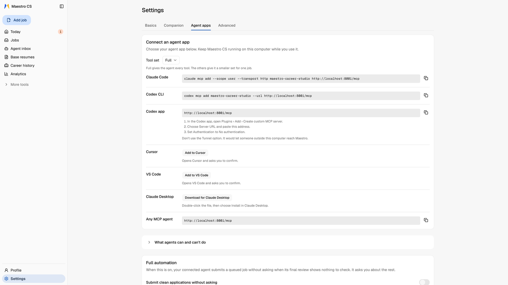

<!-- TODO(P4) mcp-chat.png — a SECOND shot for this section is still open: a
     Claude conversation answering a real question over the explore tools
     ("what keeps coming up in the jobs I'm saving that I'm not showing well?"
     -> surface vs build tiers). Two candidates exist and both need work: the
     gap-query capture reports `kb_points: 0` / "your Career KB is nearly
     empty", which argues against §1's own advice, and the base-resume-listing
     capture is one tool call ending on a question with no result. Re-capture
     against a scored instance, then save here and add below the dashboard. -->

With the app running, open Settings › Agent apps › **Connect an agent app**
and choose a **Tool set**:

- **Claude Desktop** — on a Docker install, download the `.mcpb` bundle from the card or the
  [release](https://github.com/seinun-ai/maestro-career-studio/releases), then
  double-click it. It bridges Claude's stdio connection to Maestro's local HTTP
  endpoint and needs no Docker or Python on Claude's side. Reinstall the bundle
  if you have the older Docker-based extension. On a uv install, run
  `maestro connect claude-desktop` instead: it writes Maestro into Claude
  Desktop's settings. Desktop rewrites that file while it runs, so with Desktop
  open the command waits, writes the entry after you quit it, and `--now` writes at once.
- **URL clients** — Claude Code and Codex CLI get a copyable command; Cursor and
  VS Code get install buttons; other HTTP MCP clients get a URL. The default is
  `http://localhost:8001/mcp`. Use `/mcp` exactly — no trailing slash.

**On a uv install, `maestro connect` does this from the terminal.** With no app
it lists them and says which already have Maestro; `maestro connect claude-code`,
`codex`, `cursor` or `vscode` adds Maestro to that app, and `--print` shows what
it would add without changing anything.

For Claude Code or Codex CLI, the commands are:

```bash
claude mcp add --scope user --transport http maestro-career-studio http://localhost:8001/mcp
codex mcp add maestro-career-studio --url http://localhost:8001/mcp
```

`--scope user` makes Maestro available in every folder; without it, Claude Code adds it to the current project only.

The [plugin guide](../plugins/maestro-career-studio/README.md) covers release-tag
marketplace installs. In Codex's app, use the release tag as **Git ref** and
`.agents/plugins` plus `plugins` as **Sparse paths**. Plugins connect by URL too.
Legacy stdio through `./scripts/setup-mcp.sh` remains for one release and is
removed in v0.10.0; see the [MCP guide](../backend/mcp_server/README.md#legacy-stdio).

**Things to ask once it's connected:**

- "Here's a job posting: `<paste>`. Save it, score it against my base resumes,
  and tell me what it asks for that my resume doesn't show."
- "Tailor my Data Scientist resume to that job, show me what changed, then make
  the PDF."
- "Mark the Acme application as applied, and list everything still waiting on a
  reply."
- "Across the jobs I've saved, which skills keep showing up as gaps?"

**Tool sets.** All 95 tools are on by default (`full`). Smaller sets — `hunt`,
`apply`, `explore`, `templates`, `career` — keep a chat focused; pick one in the
card's **Tool set** selector or the Claude Desktop bundle's **Tool profile**
setting. Scoped URLs end in `/mcp/hunt`, `/mcp/apply`, `/mcp/explore`,
`/mcp/templates` or `/mcp/career`. Use one set at a time.

**Skills.** [`docs/skills/`](skills/) has ready-made skills for a daily job
hunt, an apply run that asks you only for what the app doesn't know (plus one
yes before each submit), mail-status, referral pages and a tailor run.
`customize-job-skills` adapts any of them to your agent app and routine, or
asks a few questions and builds new ones from what your agent knows about you.
The **Automations** page in the app puts each one on the clipboard: copy a
prompt into any agent app connected to Maestro, and for a scheduled job your
agent asks when to run it.

`/mcp` has no authentication by design: a local process can already reach REST.
It sits behind the same Host/Origin checks as REST. Never publish port 8001 or
proxy `/mcp` beyond this computer. claude.ai and chatgpt.com web connectors are
outside this local setup.

Manual setup, every tool, and troubleshooting:
[`backend/mcp_server/README.md`](../backend/mcp_server/README.md).

### Always-on bot (optional)

An agent on a machine that stays on can work your job search while your laptop
is off. Your laptop keeps your profile, and each job has one owner.
[Run an always-on bot](always-on-bot.md) is the setup. On your laptop, open
Settings › Agent apps › Second copy and click **Copy setup prompt**. Paste
that into the agent on the other machine.

---

## The rest of the toolkit

The steps above are the core. These make each application quicker than the last.

### Talk to one resume — or one section, or one bullet

The **Assistant** (the in-app chat) works on what you pin. Pin a base resume and it works on that
one; pin a section, a job entry or a single bullet and it **refuses** edits
outside it. Pin a career history item — a project, a role, a certification — to
bring its detail into the conversation without letting the Assistant change it.
Suggested edits arrive as a card you accept or discard; nothing changes
silently.

### No more `resume_v2_FINAL(3).docx`

Every change — a manual edit, an Assistant edit, a tailoring run, even a restore —
saves a **resume version**. Open a resume's history to compare two versions or
restore one; nothing is ever lost. Old resumes you no longer use are archived,
not deleted.

### Tell it how you sound — once

A **persona** describes you as a candidate: vision, strengths, goals, working
style, how your writing should sound. Set it once in Profile › How you come across (or have it drafted
from your career history, then review and save it), and every generated document
uses that voice. It shapes tone and emphasis only — never facts.

### Health Report — is this resume sound at all?

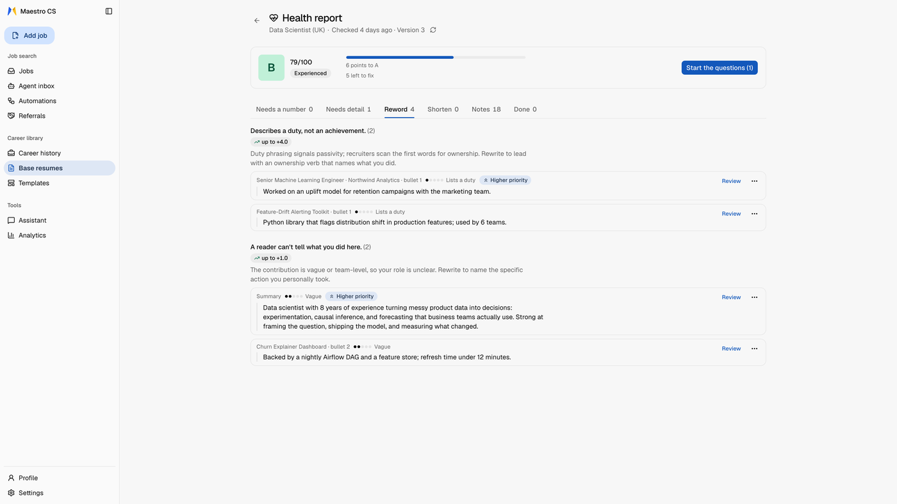

A gap needs a job. A **Health Report** doesn't: it checks one resume on its own —
can it be read by application systems, are the dates right, is the evidence
strong, is the format sound. A serious problem **blocks** tailoring, because
tailoring can't fix a broken resume. You can **Mark as OK** a check you disagree with, with a reason
on record.

### Templates you actually own

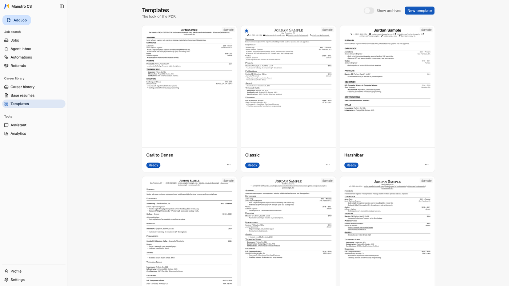

Switching templates is a button, not a rebuild: your content stays the same and
renders through any template. There are two kinds — **LaTeX** and **Typst** —
both built on your computer. Start from a bundled design, adapt one you liked,
or write your own in the built-in editor; every template is test-built and
checked so that one that application systems couldn't read never goes live.
*(The web "New template" button starts from a LaTeX template; Typst templates
are created through the API or MCP.)*

### Quick tailor, when you already know the answer

The guided gap process is the careful path. **Quick tailor** is the fast one:
one click against a job, answers taken from your saved preferences, tailored and
rendered in one go. The honesty rule still holds — a skill Maestro found no
evidence for can only go in your skills list, never into an invented bullet.

### The Companion browser extension

<!-- extension.gif: the Companion's four-step panel (Job, Resume, Fill, Track)
     on a fictional job page, captured with the fictional demo persona (Jordan
     Ellis, example.com, sample-company names); sources live in the private
     marketing repo (site-media/). Only fictional values may ever be on screen.
     1000px wide; keep any replacement under 2 MB. -->

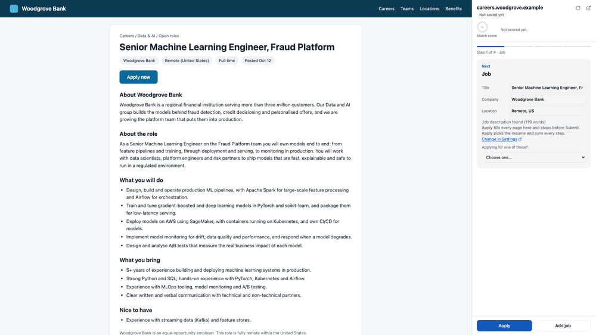

The **Companion** is a side panel in Chrome: save a job from the job board you're reading, score
it, and fill application forms from your saved answers (in **Profile**: Contact, Work permits, Start
and pay and the rest). It leaves
signatures, agreement boxes and government IDs to you unless you turn
on the agreement permission in Settings › Companion. Autofill never types a password, and the Companion never submits. Autofill does not move to the next page either; only **Apply** does, with full automation on in Settings › Agent apps (see the Companion's README).

**Screening answers** (Settings › Companion) sets how far the Companion answers a question your saved answers
do not cover. **Careful** uses only your saved answers and career history. **Balanced**, the default, also
answers low-stakes questions (how you heard about the job, travel, relocation) in the job's favor, and
years-with-a-skill questions when your history shows the skill. **Confident** also answers Yes to requirement
and years questions on jobs you queued, and asks you when your history shows fewer years.

With full automation on, a job page you have not saved yet shows **Add job** beside **Apply**: it saves the job and
scores your resumes, then stops on the ranked list without tailoring or starting anything. **Apply** shows a live checklist while it gets ready (save, score, the resume it
uses, queue, tailor, make the PDF, open the application) and a **Stop** button that ends it between steps.
Two switches under **Settings › Companion › How the Companion applies** steer it. **Choose the base resume for me**
(on) picks a resume only when its match score clearly wins, using the limits in Auto-apply, and asks you
when it is close; off, you always pick. **Stop after each step** (off) makes Apply three presses, **Save
job**, **Tailor resume** and **Start filling**, and your yes to queueing comes with the last one. When a
page refuses Next and says why, Apply fixes only the fields it names and stops if that does not help;
it attaches your resume before pressing Next and never presses Next over an empty required upload.

**Ready to submit** means nothing is missing: the page has a real Submit button and no Next, shows no
error and has no required box left empty. When Apply is not sure about a page it stops and says why:
**More than one Next**, **May send the application**, **No Next button found** or **Not sure about this
page**. Look, then press **Resume**: Apply fills what is still open first, and your Resume counts as
"this is the last page" only when no Next is left on it. Dropdowns and Yes/No buttons are fields, never
Next or Submit. On a Workday "Start Your Application" page Apply presses **Apply Manually** and nothing
else there; if it cannot, it says **Choose how to apply** and waits for you. If you start Apply on the job's own posting,
it opens the application link saved with the job rather than staying there; on a career site whose **Apply** button asks for a
new tab, Apply presses it in the same tab, but only when it leads to that link or to a known application site. When Apply waits for
a step you do by hand, it follows you into the tab you open for the application and says "The run moved to this tab"; press
**Continue here** to carry on (nothing is filled until you do). If you are on the job's tab and its run waits in another one, the
Job step offers **Move the run to this tab**; a run that is filling never moves. On a known application
site (Workday, Greenhouse, Lever, Ashby, iCIMS and a few more) that asks you to sign in, Apply signs in with the
job-site login you saved under Settings › Agent apps, in the page itself, and never retries a failed
sign-in; anywhere else it waits for you to sign in. On a known application
site that asks you to make an account, Apply makes it with your saved job-site login, once, waits up to
20 seconds for the site to finish, and only then stops with **Account not created** if the site refuses
it, **Email code** if the site wants an email check and **CAPTCHA** if it shows one. A required
written question your saved answers cannot answer is **drafted from your career history for you to
read** ("Drafted from your history: read it"), never saved as a standing answer; **Careful** turns
drafting off. The **Ask** box at the foot of the Fill step answers any question from a form in one
paragraph you can copy; it opens when a run pauses. When you fix a field by hand while a run waits, the
Companion notes which clicks and keys you used (never what you typed) and tries them first on that kind of
field next time. After you press **Submit** and the confirmation page shows, the panel marks the job applied
after 8 seconds unless you press **Undo**. If the tab goes anywhere else first, **Mark applied** is yours to
press. The Companion remembers which job each tab is on until you close the tab.

When Apply would stop on a page it could not work, it first thinks. With **Think when stuck** on (Settings ›
Companion › How the Companion applies, on by default, and only with full automation on and **Stop after each step** off),
the **Reasoning model** looks at the page: the questions, the options and the errors, never what is in a field.
It picks up to three actions, such as filling a field again, writing a short answer, choosing an option, closing
a popup or pressing Next, then looks again, for up to three rounds. While it works the card shows a live line
("Thinking: …"). If it sorted the page out you get one sentence ("Sorted it out: answered 2 questions and moved
on."). If not, the usual **Needs you** card says what it asks of you, or what it tried and whether it took ("It tried How
Did You Hear About Us? a second way; it didn't take."). Anything it wrote or chose is
listed under **Check before you submit** as answered for you. It never presses Submit, never answers
work authorization, sponsorship, salary, demographic, background or signature questions, and asks you about a fact
your profile does not have. By default the Reasoning model is your provider's strong model and costs a few cents a
round. The **Reasoning model** in **Settings › Advanced › Model per job** lets you pick another from the list, including cheaper ones
such as Claude Haiku 5.5 and GPT-6 Luna; a cheaper model costs less and may be less reliable. With the fill log
on, each round and the page it saw are recorded, so you can compare models on the same pages with
`backend/scripts/eval_reason.py`.

On a one-page form (Submit on the same page, no Next) it works the fields only, for open questions and page errors: it fills, answers, writes,
chooses and retries, and presses nothing there, not Next, not Submit and not a popup's button. It stays out of a page that asks about
submitting or shows a popup. After you update Maestro, **reload job tabs that were already open**: a tab opened before the update can
leave the Companion unable to read the page, and the card says **Reload the page**; reload it and press Resume.

A question your profile cannot answer gets a safe default from **Balanced** up: No (or Not
applicable when offered) for membership of a tribe, union or association, a referral, or relatives at the
company, and No (or "I don't wish to answer") for a spouse's or household member's military service; Yes for willingness to a standard step such as a background check, drug test, references,
I-9 or providing documents (a question of being willing to take such a step, even when the model took it for a protected one; a box that gives the consent itself, or asks whether you
would pass, is yours), and for basic means such as transport and internet. A slow Claude fast model is given more time (3 s) for its second look, and a question the model could not match to
anything of yours at any confidence reaches this check. A saved "Immediately" start date is offered as today's date in a date box and as "Immediately" in a list. Criminal or background
history, salary, work authorization, demographic questions and your own military service are never defaulted. Every default is
listed under **Check before you submit**, and so is a required field that a search or a click filled for you (Field of Study, say),
which no longer stops the run; the page's own check decides. An optional Skills box stays empty in a run. What you type in the page
while a run waits on "The page asks for more" or on an upload is remembered like any other answer. A resume that an uploader shows as a chip, or by its name some seconds later, is recognised as attached (the card says "Couldn't confirm the upload" rather than "boxes changed" when the page only swapped its box). The Companion also reads a job posting that has no built-in job data, taking the
description from the section under a "Job Description" or "About the role" heading, or from a "Description & Requirements" card on a career site that draws its sections as cards.
On the first page of an application, a page the Companion does not recognise but that has fields is filled like any other (and then waits for you if it has no Next button), instead of stopping at "Page not recognised"; search boxes are never filled. Forms built from web components are read like any other, and a vendor's "fill this from your resume" import box is never written. A DataDome slider is a verification wall, so Apply stops there for you.

Three kinds of question are answered from what you saved, and said to be assumed or checkable under **Check before you submit**. "How did you
hear about us?": if your answer is just "Job board" and the job names no board, Apply picks LinkedIn, or another job board the list offers; a job
you saved on the employer's page right after a job board page remembers that board for about 20 minutes; a referral is never a board. An education
level list ("Bachelor's degree or higher", "None of the above"): Apply picks the highest level your degrees meet, such as Bachelor's or higher
for a Master's, never "None of the above", and leaves it to you when none is met or your degree is still in progress. "What type of sponsorship
will you need?": when every sponsorship answer you saved is No, Apply picks Not applicable (or the option that says none), even when the
question counts OPT as sponsorship; with no such option, or a Yes saved, it is yours.

Three more are decided from what you saved. A **Degree** list of types ("Bachelor's Degree", "Master's Degree", "Master of Business Administration"):
Apply picks the plain option for your degree's level, and the MBA option only when your degree is an MBA or says Business Administration; a degree
still in progress, or one that names no level, is left to you. "Are you located in … and/or willing to relocate?" is answered Yes when you saved
that you would relocate; if the question adds a condition ("on your own"), the answer is listed as assumed. A **Location (City)** box is searched
as "City, State" when the form also asks for a state, and Apply picks the option for your city in your state; two matches, or no saved state,
leave it to you. An optional field you have a saved answer for that stayed empty is listed under **Check before you submit** as **Left for
you**; it never stops the run. An optional field the run left blank is listed there too, as **Left blank — optional**, and goes when a later fill answers it.

Veteran status is one question in **Profile › Diversity questions**: "Are you a veteran?" (Yes, No, or "I don't
wish to answer"). A No answers every "I am not a protected veteran" option on a form, and picks the one such option on a list without asking a model. A Yes never picks
a protected class for you, so the Companion leaves that list to you, and a Yes never answers "are you currently serving?" either. A No
also answers "have you ever served?" with the never-served option, and says it was assumed. If your Profile still held the old
"Not a protected veteran" answer, the question is empty and asks again.

It can keep a **fill log**: *which* fields it met and whether they filled,
never what you typed. The log is off unless you tick **Keep a fill log** in the
Companion's options (right-click its toolbar icon, then **Options**). It stays
on your computer, but it does show which companies you applied to and when, so
it is yours to switch on. With it on, **Settings → Advanced → Autofill coverage** shows
where autofill misses; **Clear data** there deletes it.

### Analytics: what the market keeps asking you for

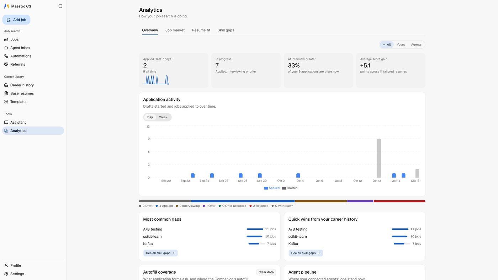

Every saved job adds to a picture of the market you're applying into — top
skills, a skill heatmap, role mix over time — filterable by role, level and job
type. The most useful view is **Skill gaps**: skills jobs keep asking for,
marked as *not in your career history*, *in your career history* or *used before*. Frequent
and missing is worth learning next; frequent and already in your history is
something you have but keep forgetting to say. **Resume fit** shows the score
before and after tailoring for each base resume, so you can see whether
tailoring is helping.

### Hunt with the agent you already use

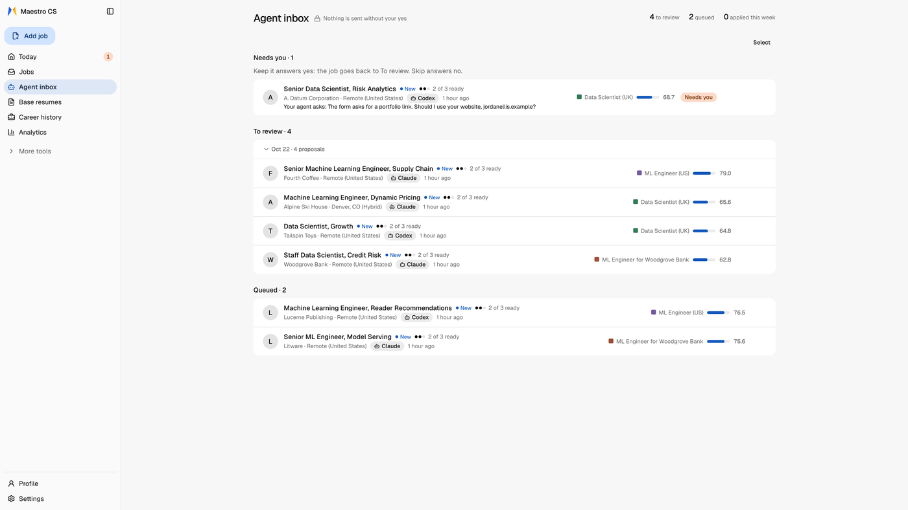

Your AI assistant can job-hunt for you. It reads your job preferences from the
app, finds postings on whatever sites it can use, saves and scores them against
your resumes, and hands back a ranked shortlist for you to review. There's no
job-board integration to be locked into.

Ready-made skills (`job-hunt`, `apply-session`, `apply-auto`, `mail-status`, `referral-pages`,
`tailor-run`) are in [`docs/skills/`](skills/) — copy a prompt from the
app's **Automations** page into any agent app connected to Maestro (for a
scheduled job, your agent asks when to run it), copy the skills into your
assistant's skills folder as-is, or run **`customize-job-skills`** to adapt them
to your agent app and routine or build new ones (batch tailoring,
referral-first hunting, a weekly digest) from your own data.

### Going all the way: agent applications

<!-- TODO(P4) proposals.png — the /proposals view: the Captured/Proposed/
     Accepted/Approved/Submitted counters, the daily cap chip, and the queued
     proposals with their match scores. It shows this section's core claim -- the
     lane stops before submitting -- in the app's own words ("What the hunt
     found. Submitting still needs your approval."). Captured but not yet saved
     to a file; drop it at docs/assets/proposals.png and uncomment: -->
<!--  -->

Maestro CS can take an application right up to the submit button. Read this
part rather than skim it.

A job your agent finds becomes a **proposal**. You review proposals in the
**Agent inbox** and **Queue** or **Skip** them (in bulk if you like). The inbox
opens with one line of what is waiting (how many need you, wait for review, are
queued, or went out this week), then only the lanes that have something in them. The search and
filters appear once the inbox holds more than ten, and the daily limit shows when
you are close to it. What each automation run did is on the **Automations** page. An
apply run then works **only the ones you queued**: it tailors, renders and
fills each application in a live agent session with a browser, asks you only
for information the app doesn't have (and hands you logins, CAPTCHAs and
signatures), and **waits for your yes before each submit**. Nothing is ever submitted from the web app itself, and a daily limit
you set caps how many submissions are possible.

**Full automation** is off by default, in Settings › Agent apps. Turned on, your agent may submit a
queued job without asking when its final review shows nothing to check, within the daily limit and never
for a company under **Companies to skip**. A job with anything to check goes to **Needs you**, and the
agent asks you. Your agent can also get the job-site login you save there, so that login passes through
your agent's AI provider. The **Apply automatically** prompt (`apply-auto`) on the Automations page runs
this. The same switch turns on the Companion's **Apply**, which never presses Submit.

Be clear about what that yes is: the agent records it, so the record shows *that
the agent said you agreed*. It's an audit trail and a volume limit, not a lock
that a manipulated agent can't pick — so run it while you're watching. An agent
can't mark an application submitted without a confirmation or your own word,
and if it can't tell whether a submit went through, it stops and never clicks
again.

**The risks, plainly.** Letting an agent read job pages and drive a browser
means three real exposures:

- **Manipulated instructions.** A job posting is untrusted text; text hidden in
  one can try to instruct the agent reading it.
- **Unverified employers.** A posting the agent found isn't a vetted one, and an
  application sends your contact details and history to whoever posted it.
- **Bot detection.** Some employers filter applications that look automated, and
  we won't help you hide it — no stealth browsing, no CAPTCHA bypass, no
  invisible (headless) submitting. See
  [Project Scope](../CONTRIBUTING.md#2-project-scope).

Use it on jobs you have looked at yourself. Everything is written down —
proposals, your yes, and the screenshots behind them.

### Your resumes folder

Every finished resume PDF, and every cover letter PDF, is also copied to a folder
you can see: `Documents/Maestro Career Studio/Applications` (on Windows, your real
Documents folder, even when OneDrive moved it). Each job gets one folder named
`Company – Job title (date)`. The name is chosen once, so editing the job title
later does not move it, and two jobs with the same name get a "(2)" on the second.

The copy happens after you create or update a PDF, after a cover letter is
rendered and after a job arrives from your second copy. Every start also
copies the resume PDFs you already have, with their cover letters, skipping the ones
already there, and so does changing the folder or switching copies back on. Maestro only writes there. It
never reads a copy back and never deletes anything. Deleting or renaming a copy is
fine: Maestro brings a job's copy back only when that resume changes (a new PDF) or
you click **Show in Finder**.

**Show in Finder** (**Show in File Explorer** on Windows, **Show in folder** on
Linux) on the PDF card and in the tailored-resume studio opens the copy. In Settings ›
Basics › **Resume PDFs** you can switch it off, **Open folder**, **Change
folder** (type a path or press **Choose…**) or **Use the default**. If a copy
fails, for example because a drive is unplugged, the last problem shows there.
The Docker route keeps PDFs in `applications/` instead and has no resumes folder.

### Leave with everything

`career.md` is your whole career history as one Markdown file — downloadable from
the Career history page or over MCP. Every application's PDF is saved in
`applications/`, in a folder named after the company and role, so checking what
you actually sent is opening a folder. Your data is yours, in files on your
disk, and nothing about leaving is made difficult.
